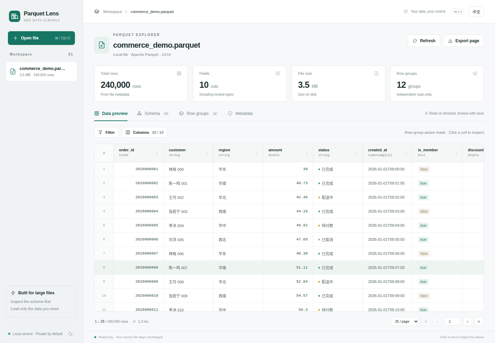

# Parquet Lens: A Clearer View of Your Data

[](pyproject.toml)
[](LICENSE)
[](#-getting-started)

**English** | [简体中文](README_zh.md)

<p align="left">
  
</p>

## 📢 News

- **[November 3, 2026]** Added English / Chinese interface switching with a saved language preference, bilingual documentation, and the MIT license.
- **[November 3, 2026]** Implemented the local-first explorer with schema inspection, row-group-aware paging, filtering, and sorting; verified a 50-million-row file.

## 📌 Overview

**Parquet Lens** is a local-first, cross-platform Parquet explorer. A Python service reads your files while a browser presents their structure and content. Run it on Windows, macOS, or Linux; access it from a phone or tablet over a trusted local network.



Key features:

- **Understand the schema:** inspect field types, nullability, nested lists / structs / maps, row groups, and file metadata.
- **Explore large files:** inspect the footer first, select columns, and load a bounded page instead of the entire dataset.
- **Find relevant rows:** combine AND filters, cycle through ascending / descending / no sort, and inspect individual rows.
- **Keep control of your data:** read-only source access, local processing, no external web assets, and protected session links.
- **Use your preferred language:** switch between English and Chinese from the top bar on desktop or mobile. The choice is saved in your browser; file contents are never translated.
- **Export what you see:** download the current page as CSV or copy a row as JSON. Long values are explicitly marked as truncated previews.

## 🚀 Getting Started

### Requirements

- **64-bit Python 3.10+**, preferably Python 3.12.
- A modern browser, such as Chrome, Edge, Firefox, or Safari.
- Internet access for the initial dependency installation. Once installed, the interface and file reader work without external services. **Node.js is not required.**

### Quick start

| Platform      | Start from the project directory |
| ------------- | -------------------------------- |
| Windows       | Double-click `start.bat`         |
| macOS / Linux | Run `sh start.sh`                |

The scripts create an isolated environment, install missing dependencies, and open the browser. Keep the terminal running; press `Ctrl+C` to stop the service.

### Install with uv

Use the included lockfile for reproducible dependencies:

```sh
uv sync --locked
uv run parquet-lens

# Open a file at startup
uv run parquet-lens /path/to/data.parquet
```

### Install with Python and pip

macOS / Linux:

```sh
python3 -m venv .venv
.venv/bin/python -m pip install .
.venv/bin/python -m parquet_lens
```

Windows:

```powershell
py -3 -m venv .venv
.venv\Scripts\python -m pip install .
.venv\Scripts\python -m parquet_lens
```

The default address is `127.0.0.1:8765`. Open the **complete access link printed in the terminal**. Its random token is exchanged for an HttpOnly session cookie and removed from the address bar. If the port is occupied, add `--port 18765`.

## 🧭 Usage

1. Choose **Open file**, drop a `.parquet` / `.pq` file, or enter an absolute local path. **For GB-scale local files, use the path** to avoid copying or uploading.
2. In **Data preview**, choose columns and add AND filters. Click a column header to cycle through ascending, descending, and no sort.
3. Click a row to inspect the loaded fields, copy JSON, or move between rows on the current page.
4. In **Schema**, inspect nested fields and nullability. Scalar fields show per-row-group minimum, maximum, and null counts when recorded in the footer.
5. In **Row groups**, inspect row ranges, compressed sizes, and space savings, then jump directly to a group's data.
6. In **Metadata**, inspect the format version, writer, and custom key-value metadata. **Export page** downloads the current rows and selected fields as CSV.
7. Use the **中文 / English language button** in the top bar to change the interface language without reopening the file or resetting filters, sorting, selected columns, or the current page.

The built-in sample has 240,000 synthetic rows, including timestamps, booleans, nulls, lists, and structs. Its Chinese data values remain unchanged in the English interface.

Shortcuts: `Ctrl/Cmd+O` opens a file; enter a page number and press `Enter` to jump; `Esc` closes the row inspector. Light and dark themes are available.

## 📱 Phones, Tablets, and LAN Access

Start the service on your computer:

```sh
uv run parquet-lens --host 0.0.0.0 --port 8765
```

Replace `127.0.0.1` in the printed access link with your computer's LAN IP, then open it on a device on the same network. Allow the chosen port through your computer's firewall if necessary.

- The computer must remain running. Phones and tablets use the browser interface; there is no standalone mobile installer.
- Remote devices can upload files. Opening a server-side path is restricted to requests from loopback addresses.
- Devices holding the same link share the workspace and open files. Uploaded files are temporary and are removed when closed or when the service shuts down normally. Source files remain read-only.
- The default listener is local-only. LAN HTTP mode is intended for a trusted network, not direct public exposure. The complete link grants workspace access.

## ⚡ Large-File Design

| Mechanism               | Behavior                                                                                                                                                                                         |
| ----------------------- | ------------------------------------------------------------------------------------------------------------------------------------------------------------------------------------------------ |
| Footer-first inspection | Read the schema and total row count from metadata, without a full-table COUNT.                                                                                                                   |
| Row-group-aware paging  | Binary-search cumulative row counts, then read the relevant group in 256-row batches. Earlier row groups are skipped; decoding within a group may start at its beginning.                        |
| Column projection       | Default to the first 20 top-level fields, with up to 80 selected fields and 200 rows per page.                                                                                                   |
| Bounded queries         | Parameterized DuckDB filters / sorts; default 256 MB query memory, 2 GB disk spill, 20-second timeout, and two concurrent data reads. Filtered totals are not scanned separately.                |
| Bounded previews        | Strings up to 4,096 characters; nested collections up to 50 items and 5 levels, subject to preview budgets. Large integers and decimals are strings, timestamps use ISO, and binary uses Base64. |
| Bounded responses       | Reject pages over 8 MB with guidance to choose fewer rows / columns. CSV exports use empty cells for null and escape text formula prefixes.                                                      |

DuckDB's memory setting is **not a hard limit on the entire process**. Arrow decoding, very large individual values, wide schemas, and unusually large row groups can still increase memory usage and latency. Global sorts, low-selectivity filters, and deep paging through query results may scan substantial data; resource limits stop expensive queries with an explanatory message.

Configuration examples:

```sh
uv run parquet-lens --memory-limit 512MB --query-timeout 30 --max-upload-gb 50
uv run parquet-lens --no-browser --port 18765
```

## 📊 Performance

Recorded Linux engine benchmark: **50,000,000 rows**, 8 top-level fields, 407 row groups, ZSTD compression, **2,031.0 MiB / 1.98 GiB**, 100 rows per page.

| Operation                    |    Result |
| ---------------------------- | --------: |
| Footer and schema inspection |    1.9 ms |
| First page                   |   15.5 ms |
| Middle page                  |   13.4 ms |
| Last page                    |   16.0 ms |
| Peak reader-process RSS      | 128.3 MiB |

These are single measurements with warm local caches after file generation, excluding upload, network, and browser rendering time. They are not guarantees for other files or machines. Recovery to ordinary paging after a large-file query timeout has also been verified.

Reproduce the benchmark:

```sh
uv run python scripts/benchmark.py --rows 50000000
```

The script creates a temporary file, probes reads in an isolated process, and cleans up afterward. Use `--output /path/benchmark.parquet` to keep it; existing files are never overwritten.

## 🧪 Development and Validation

```sh
uv sync --locked --extra dev
uv run pytest -q
```

Tests cover row-group boundaries, deep-page skipping, column ordering, numeric precision, nested values, filtering and sorting, identifier escaping, upload cleanup, file-change detection, access control, and localization. On machines with unrelated global pytest plugins, set `PYTEST_DISABLE_PLUGIN_AUTOLOAD=1`.

The interface has been validated in Linux / Chrome, including a 390px mobile viewport. The same Python implementation supports Windows / macOS, and the included CI matrix targets all three platforms with Python 3.10 and 3.12; Windows / macOS have not been verified on physical machines in this workspace.

## 🗂 Project Layout

```text
parquet_lens/
  cli.py              Startup options, access links, and browser launch
  engine.py           Footer inspection, row-group paging, bounded queries
  server.py           Read-only API, uploads, and session access control
  i18n.py             Localized API errors using the shared message catalog
  sample.py           Deterministic sample data
  static/
    app.js            Browser interface; no frontend build step
    i18n.js           Language selection and marked interface translations
    locales/en.json   Shared English translations; Chinese source strings
README.md             English documentation
README_zh.md          Chinese documentation
LICENSE               MIT license
scripts/              Reproducible large-file benchmark
tests/                Engine, API, and localization tests
```

Current scope: individual, complete, unencrypted Parquet files. Directory datasets, cloud-storage URLs, editing, arbitrary SQL, per-user isolation, and duplicate / case-only-different top-level field names are not supported. Workspaces reset on restart. Force-terminating the process may leave `parquet-lens-*` directories in the system temporary folder; these can be removed after the service stops.

## 📄 License

Copyright © 2026 yannlau. This project is licensed under the [MIT License](LICENSE).

## 🙏 Acknowledgements

- [GalaxeaVLA](https://github.com/OpenGalaxea/GalaxeaVLA) for the bilingual README organization.
- [DuckDB](https://duckdb.org/docs/data/parquet) and [Apache Arrow](https://arrow.apache.org/docs/python/parquet.html) for the underlying Parquet tooling.
