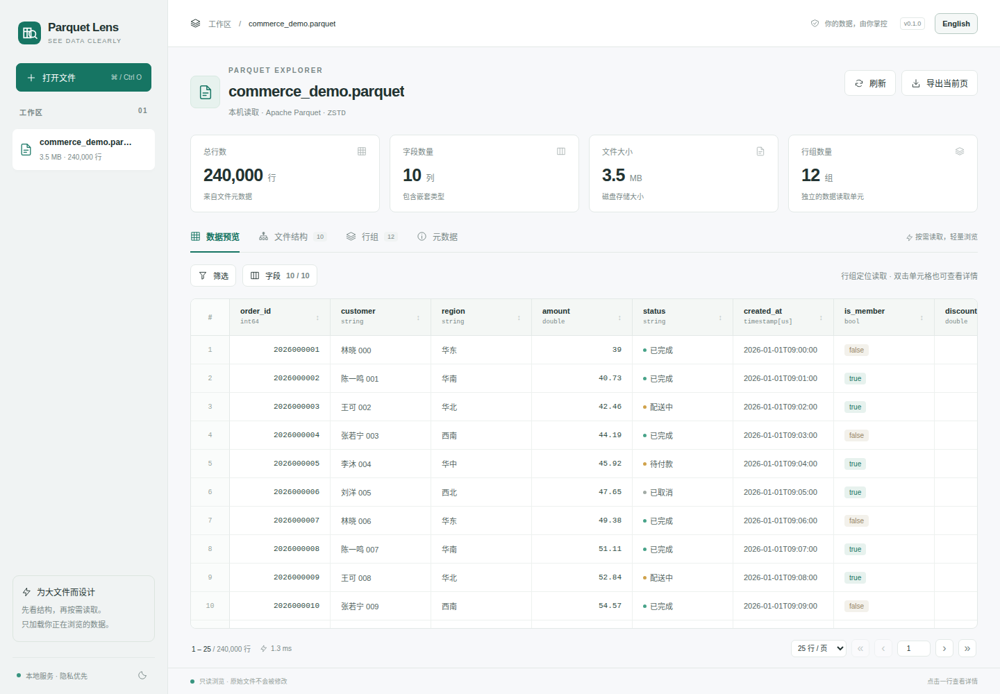

# Parquet Lens：看清每一层数据

[](pyproject.toml)
[](LICENSE)
[](#-快速开始)

[English](README.md) | **简体中文**

<p align="left">
  
</p>

## 📢 最新动态

- **[2026 年 11 月 3 日]** 新增中英文界面切换与语言偏好记忆、中英文文档，以及 MIT 开源许可证。
- **[2026 年 11 月 3 日]** 实现本地优先的 Parquet 浏览器，支持结构查看、行组分页、筛选与排序，并完成 5,000 万行文件验证。

## 📌 项目概览

**Parquet Lens** 是一款本地优先、跨平台的 Parquet 可视化软件。Python 服务负责读取文件，浏览器负责展示结构与内容。支持 Windows、macOS、Linux，手机和平板可通过可信局域网访问。



主要功能：

- **看懂文件结构**：展示字段类型、可空属性、嵌套列表 / 结构体 / 映射、行组和文件元数据。
- **按需浏览大文件**：先读页脚、按列裁剪、分页加载，避免一次性读入整个数据集。
- **快速找到数据**：支持多个 AND 筛选条件、升序 / 降序 / 取消排序，以及单行详情。
- **掌控自己的数据**：源文件只读、数据本地处理、界面无外部网页资源，并以会话链接控制访问。
- **选择界面语言**：桌面和手机顶栏都可切换中文 / English，浏览器会记住选择；文件内容不会被翻译。
- **导出当前所见**：当前页导出 CSV，单行复制 JSON；超长值会明确标记为截断预览。

## 🚀 快速开始

### 环境要求

- **64 位 Python 3.10+**，推荐 Python 3.12。
- Chrome、Edge、Firefox、Safari 等现代浏览器。
- 首次安装需要联网下载依赖，安装后界面与文件读取不依赖外部服务。**无需 Node.js。**

### 一键启动

| 平台          | 在项目目录中启动   |
| ------------- | ------------------ |
| Windows       | 双击 `start.bat`   |
| macOS / Linux | 执行 `sh start.sh` |

启动脚本会创建独立环境、安装缺失依赖并自动打开浏览器。保留终端窗口即可持续使用，按 `Ctrl+C` 停止服务。

### 使用 uv 安装

通过随附锁文件复现依赖：

```sh
uv sync --locked
uv run parquet-lens

# 启动时打开文件
uv run parquet-lens /path/to/data.parquet
```

### 使用 Python 和 pip 安装

macOS / Linux：

```sh
python3 -m venv .venv
.venv/bin/python -m pip install .
.venv/bin/python -m parquet_lens
```

Windows：

```powershell
py -3 -m venv .venv
.venv\Scripts\python -m pip install .
.venv\Scripts\python -m parquet_lens
```

默认地址为 `127.0.0.1:8765`。请打开**终端输出的完整访问链接**。随机密钥会换成 HttpOnly 会话 Cookie，然后从地址栏移除。端口被占用时添加 `--port 18765`。

## 🧭 使用指南

1. 点击**打开文件**，选择 / 拖入 `.parquet`、`.pq` 文件，或输入本机绝对路径。**GB 级本机文件推荐使用路径**，避免复制和上传等待。
2. **数据预览**按页加载内容。可选字段、添加多个 AND 条件，点击列头依次切换升序 / 降序 / 取消排序。
3. 点击任意行查看已加载字段的值，可复制 JSON、切换同页上一行 / 下一行。
4. **文件结构**展示数据类型、可空属性和嵌套层级；标量字段可查看页脚中记录的各行组最小值、最大值和空值数。
5. **行组**展示行范围、压缩大小与空间节省比例，可直接跳转到该组的数据。
6. **元数据**展示格式版本、写入工具和自定义键值信息；**导出当前页**输出当前行及所选字段的 CSV。
7. 使用顶栏的 **中文 / English 语言按钮**即时切换界面，无需重新打开文件；筛选、排序、已选字段和当前页都会保留。

自带 24 万行演示数据，含时间、布尔值、空值、列表与结构体。演示数据中的中文值在英文界面下也会保持原样。

快捷键：`Ctrl/Cmd+O` 打开文件，页码框输入后按 `Enter` 跳转，`Esc` 关闭行详情。支持明暗主题。

## 📱 手机、平板与局域网访问

在电脑启动服务：

```sh
uv run parquet-lens --host 0.0.0.0 --port 8765
```

将终端访问链接里的 `127.0.0.1` 换成电脑的局域网 IP，在同一网络中的设备浏览器打开。必要时允许该端口通过电脑防火墙。

- 电脑需要保持运行；手机和平板使用浏览器界面，没有独立的移动端安装包。
- 远程设备可上传文件；读取服务端本机路径仅允许来自回环地址的请求。
- 持有同一链接的设备共享工作区及已打开文件。上传内容是会话临时文件，关闭文件或正常停止服务时清理；源文件始终只读。
- 默认仅监听本机。局域网 HTTP 模式适用于可信网络，不应直接暴露到公网；完整访问链接即工作区密钥。

## ⚡ 大文件读取设计

| 机制       | 行为                                                                                                                                 |
| ---------- | ------------------------------------------------------------------------------------------------------------------------------------ |
| 元数据优先 | 从 Parquet 页脚读取结构和总行数，不执行全表 COUNT。                                                                                  |
| 行组定位   | 二分定位累计行数，再按 256 行批次读取目标组，跳过此前行组；行组内部仍可能从该组起点解码。                                            |
| 列裁剪     | 默认前 20 个顶层字段，最多选择 80 个，每页最多 200 行。                                                                              |
| 受控查询   | DuckDB 参数化筛选 / 排序，默认单查询内存 256 MB、磁盘溢写 2 GB、20 秒超时，最多同时执行 2 个数据读取请求；不额外扫描筛选结果总行数。 |
| 有界预览   | 字符串最多 4,096 字符；嵌套集合最多 50 项、5 层并受预算约束。大整数和 Decimal 用字符串传递，时间用 ISO，二进制用 Base64。            |
| 有界响应   | 单页超过 8 MB 时提示减少行数 / 字段；CSV 将 null 输出为空单元格，并转义文本公式前缀。                                                |

DuckDB 的内存设置**不是整个进程的硬内存上限**。Arrow 解码、极大的单个值、超宽结构和超大行组仍会增加内存与耗时。全局排序、低选择性筛选和筛选结果的深页跳转也可能扫描大量内容；达到资源限制后会停止查询并说明原因。

参数示例：

```sh
uv run parquet-lens --memory-limit 512MB --query-timeout 30 --max-upload-gb 50
uv run parquet-lens --no-browser --port 18765
```

## 📊 性能验证

已记录的 Linux 引擎层实测：**50,000,000 行**、8 个顶层字段、407 个行组、ZSTD 压缩、文件 **2,031.0 MiB / 1.98 GiB**，每页 100 行。

| 操作                 |      结果 |
| -------------------- | --------: |
| 页脚与结构读取       |    1.9 ms |
| 第一页               |   15.5 ms |
| 中间页               |   13.4 ms |
| 最后一页             |   16.0 ms |
| 独立读取进程峰值 RSS | 128.3 MiB |

这些是文件刚生成后的本机缓存条件下的单次结果，不含上传、网络和浏览器渲染时间，也不代表其他机器或文件的保证。另已验证大文件查询超时后可恢复普通翻页。

复现基准：

```sh
uv run python scripts/benchmark.py --rows 50000000
```

脚本生成临时文件，在独立进程中测试读取，完成后清理。用 `--output /path/benchmark.parquet` 保留文件；已有同名文件不会被覆盖。

## 🧪 开发与验证

```sh
uv sync --locked --extra dev
uv run pytest -q
```

测试覆盖行组边界、深页跳过、字段顺序、数值精度、嵌套数据、筛选排序、标识符转义、上传清理、文件变化检测、访问控制和国际化。若机器上无关的全局 pytest 插件造成干扰，可设置 `PYTEST_DISABLE_PLUGIN_AUTOLOAD=1`。

界面已在 Linux / Chrome 验证，包括 390px 手机视口。Windows / macOS 使用相同 Python 实现，随附 CI 矩阵覆盖三平台与 Python 3.10、3.12；本工作区尚未在 Windows / macOS 实机验证。

## 🗂 项目结构

```text
parquet_lens/
  cli.py              启动参数、访问链接与浏览器入口
  engine.py           页脚检查、行组分页、受控查询
  server.py           只读接口、上传与会话访问控制
  i18n.py             通过共享文案表提供双语 API 错误
  sample.py           可复现的演示数据
  static/
    app.js            浏览器界面，无需前端构建
    i18n.js           语言偏好与显式标记的界面文案翻译
    locales/en.json   共享英文翻译，以中文原文为键
README.md             英文文档
README_zh.md          中文文档
LICENSE               MIT 许可证
scripts/              大文件性能基准
tests/                引擎、接口与国际化测试
```

当前支持单个、完整、未加密的 Parquet 文件；不支持目录数据集、云存储 URL、文件编辑、任意 SQL、多用户隔离，以及重名 / 仅大小写不同的顶层字段。工作区在服务重启后重置。异常强制终止可能在系统临时目录遗留 `parquet-lens-*` 文件夹，可在服务停止后清理。

## 📄 开源许可证

Copyright © 2026 yannlau。本项目使用 [MIT License](LICENSE)。

## 🙏 致谢

- [GalaxeaVLA](https://github.com/OpenGalaxea/GalaxeaVLA)：中英文 README 的组织方式参考。
- [DuckDB](https://duckdb.org/docs/data/parquet)、[Apache Arrow](https://arrow.apache.org/docs/python/parquet.html)：底层 Parquet 数据读取工具。
